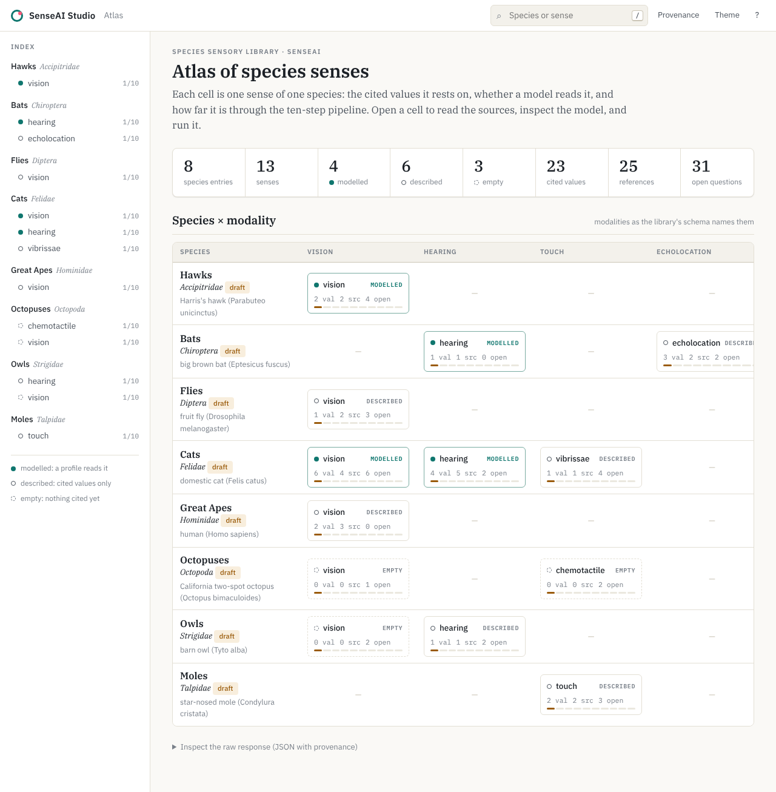

# SenseAI Studio

The place to work on SenseAI's species sense models. Pick a species and a sense, and one screen
shows:

- **Sources:** the peer-reviewed values the model stands on, with their papers;
- **Model:** what has been built from them (circuits, profile rules, world prior, learned
  networks, reflex);
- **Run:** the model in real time, on a recording or on synthetic data;
- **Pipeline:** how far that species is through the ten-step pipeline;
- **Use cases:** what it could be used for, in the founder's words.



Two rules shape Studio:

1. **Facts, not prose.** Every item on screen is rendered from a record in a repo (library YAML,
   `CITATIONS.md`, profile specs, research requests, bench events) or from the founder's files
   in `content/`. Every API response carries `provenance: [{field, source_file, line_or_key}]`,
   and the UI shows the file and line beside each value. Studio makes no LLM call. The Research
   tab is a proxy to the `research` service.
2. **Honest badges.** Studio labels every caveat on the item it applies to:

   | badge | applies to |
   |---|---|
   | *synthetic* | runs on synthetic data |
   | *untrained* | worlds with no trained checkpoint |
   | *hand-set literal* | profile values set by hand |
   | *proposed* | flagged world-prior parameters |
   | *not pre-registered* | exploratory runs |
   | *not tabled* / *unverified* | values without a verified evidence-table row |
   | *circuits: not installed* | when the circuits CLI is missing |
   | *no data for this sense yet* | senses with no stream |

   Disabled options stay visible, with the reason they cannot run.

## Screens

| | |
|---|---|
| **Atlas** (`/studio`) | Totals across the library, then a species × modality matrix. Each cell is a sense: *modelled* (a profile reads it, from `research.consumers_by_path`), *described* (cited values, no profile) or *empty*, with its counts of values, sources and open questions and a ten-step progress bar. A sidebar index, search (`/`), a provenance toggle (`p`), light/dark (`t`) and tab keys (`1`–`6`) work on every page. |
| **Sources** | A table of every value of the sense (value, unit, species, confidence, verification) with numbered references. Rows expand to conditions, notes, the verbatim quote and the model parameters that read the value. Below: open questions and research requests, then the bibliography from `CITATIONS.md` (DOI, how much was read, copy reference). |
| **Model** | *Fig. 1* traces every cited value to the rules and model parameters it sets. *Circuits*: the senseai-circuits knob registry, grouped by circuit (only those serving this modality), each knob's species value or "circuit default", range, kind (measured / proposed / physics) and basis; plus the rulebook. *Profile rules*: each head/reflex field, the rule that sets it, the library path it reads, the computed value. *World prior*: `PriorParams.from_library(<clade>.yaml).provenance()`, measured / proposed / physics. *Learned networks*: checkpoints (params, model id, tokenizer, training data) or "untrained". *Reflex*: commit threshold per profile. |
| **Run** | Pick a data source (a DSEC recording under `SENSEAI_DATA_ROOT`, or *synthetic*) and arms (each profile that reads the sense on the structured prior; the control profile; learned arms only with a checkpoint), then press Run. While it runs: the latest frame with the bearing ring, global surprise per arm, the reflex state, latency p99, and fires as they happen. Afterwards: the side-by-side and the replay report. Banners: *synthetic*, *not pre-registered*, *structured prior*. Links the frozen pre-registration and its verdict when bench has one. |
| **Pipeline** | The ten steps (`content/pipeline.yaml`, or profiles' `docs/pipeline/steps.yaml`) as a checklist with dates and evidence, and the clock: days since step 1, *partial* when steps were done out of order. |
| **Use cases** | `content/use_cases/<niche>.<sense>.md`, rendered, with the pipeline step beside every claim. |
| **Research** | Only when `RESEARCH_URL` is set: the research service's chat focused on `<clade>.senses.<sense>`, with its approval cards. |
| **Explore** (`/studio/explore`) | Any animal, whether or not the library has it. Search by common or scientific name (GBIF's backbone taxonomy). A taxon's page ranks its senses by how many papers name the animal and the sense in their title or abstract (OpenAlex; the terms per sense are in `content/senses.yaml`, and each count shows the query it came from). A sense's page lists those papers, most cited or newest, with papers per year, abstracts and free full-text links. When `RESEARCH_URL` is set, *Summarise this research* asks the research assistant for a sourced summary. Links into the workspace when the library covers the taxon. |

Screenshots on the real stack (structured prior, no training, circuits P1) are in
[`docs/screens/`](docs/screens):

- owls → hearing: `strigidae-hearing-*.png`
- cats → vision: `felidae-vision-*.png`
- cats → hearing: `felidae-hearing-*.png`
- dark theme: `dark-*.png`

## Run it

```bash
make install                      # uv sync --extra dev, npm ci
export SENSEAI_PROFILES_REPO=~/senseai/profiles
make serve                        # builds the web app, serves http://127.0.0.1:8200/studio
senseai-studio check              # what is missing, per species and sense
senseai-studio check --write-templates   # a use-case template for every clade+sense without one
scripts/studio-ctl.sh start|status|stop   # background service; status also checks viewer and research
```

The read-only screens work with only a profiles checkout: no data, circuits or research needed.
They use the checkout's own senseai-profiles code (`Registry`, `consumers_by_path`) in a probe
subprocess. If that code cannot run, they fall back to reading the spec YAML and say so.

**Runs** need `senseai-bench` with
[bench#5](https://github.com/senseai-institute/bench/pull/5): `replay-compare --synthetic` and
`profile:<name>@<world>` arms. Studio detects features from `replay-compare --help`; with an
older bench, synthetic runs and non-Panther arms are disabled, each with the reason. Settings
use the viewer runner's names (see [`.env.example`](.env.example)):

- `SENSEAI_PROFILES_REPO`
- `SENSEAI_STACK_DIR`
- `SENSEAI_DATA_ROOT`
- `SENSEAI_BENCH_CMD`
- `SENSEAI_BENCH_PYTHON`
- `SENSEAI_WORLD_CKPT` + `SENSEAI_TOKENS_YAML`
- `RESEARCH_URL`, `RESEARCH_PROXY_TOKEN`
- `STUDIO_CONTENT`
- `VIEWER_PASSWORD`, with user `senseai`

Basic auth covers everything except `/healthz` and `/api/studio/health`.

## The Research tab (senseai-institute/research)

The research service is the backend and the source of truth for the evidence ledger, the
research assistant, impact previews, experiments and library proposals. Studio reaches it
through its own proxy, `/api/studio/research/*` → `RESEARCH_URL/api/research/*`, adding the
signed-in name (`X-SenseAI-User`) and the shared secret (`X-SenseAI-Proxy-Token`, from
`RESEARCH_PROXY_TOKEN`). Headers of those names sent by the browser are dropped.

- `web/src/research/client.ts`: a typed call for every research route. The contract is
  research's `docs/API.md`; the schemas are at `/api/studio/research/openapi.json`.
- `web/src/research/adapt.ts`: research payloads and chat events → what Studio renders. Its
  tests run against events recorded from the research service
  (`web/src/research/fixtures/research_events.json`); re-record them with research's
  `packages/senseai-research/scripts/record_events.py` when research changes a payload.
- `web/src/tabs/research.ts`: the tab. Chat on the left; on the right *To check* (this
  clade's least-verified values and open questions), *Claim*, *Impact*, *Experiment* and
  *Settings* (which API keys the research service has, with a *Test* button each).

To run both on Railway, follow research's `docs/DEPLOY.md`: set `RESEARCH_URL` and
`RESEARCH_PROXY_TOKEN` here, and the same token on the research service.

## Deploy on Railway

The repo root deploys as-is: `railway.json` selects the `Dockerfile` and health-checks `/healthz`.
Set these service variables:

| variable | required | meaning |
|---|---|---|
| `VIEWER_PASSWORD` | yes | shared password (user `senseai`). On Railway the container refuses to start without it |
| `SENSEAI_PROFILES_GIT` | yes | `https://github.com/senseai-institute/profiles`, cloned at start (shallow) |
| `GITHUB_TOKEN` | if profiles is private | a read-only token for that repo. It is used for the clone and removed from the checkout's git config |
| `SENSEAI_PROFILES_REF` | no | branch or tag to deploy (default: the repo's default branch) |
| `RESEARCH_URL` | no | shows the Research tab: `http://${{research.RAILWAY_PRIVATE_DOMAIN}}:8100` |
| `RESEARCH_PROXY_TOKEN` | with `RESEARCH_URL` | `${{research.RESEARCH_PROXY_TOKEN}}`, the shared secret research checks |
| `SENSEAI_CONTACT_EMAIL` | no | sent to OpenAlex so Explore's searches use its faster queue (same variable as research) |
| `OPENALEX_API_KEY` | no | an OpenAlex key, for a larger daily allowance |

Railway sets `PORT` itself. The clone is refreshed on each deploy or restart. Without a bench
stack in the container, every screen except Run works, and Run says why it cannot.

## API

OpenAPI is at `/api/studio/openapi.json` (snapshot: [`docs/openapi.json`](docs/openapi.json)).
This is the interoperability contract:

```
GET  /api/studio/species                         cards (clade, names, niche, senses[{id,state,data,step}])
GET  /api/studio/{clade}/{sense}/sources         quantities with citations, table status, open questions
GET  /api/studio/{clade}/{sense}/model           circuits, profiles, world_prior, learned, reflex
GET  /api/studio/{clade}/{sense}/pipeline        steps[{n, name, done, at, detail}], at, clock{days, partial}
GET  /api/studio/{clade}/{sense}/use-cases       rendered markdown + front matter
GET  /api/studio/{clade}/{sense}/run/options     data sources, arms (with disabled reasons), prereg
POST /api/studio/{clade}/{sense}/run             {source, arms, seconds} -> job
GET  /api/studio/jobs/{id}/events                SSE: bench's live events contract
GET  /api/studio/health                          repos found, SHAs, circuits/research installed, data root
GET  /api/studio/explore/species?q=              any taxon by name (GBIF), with its library entry
GET  /api/studio/explore/taxon/{key}             its senses, ranked by paper count (OpenAlex)
GET  /api/studio/explore/taxon/{key}/{sense}/papers   the papers (sort=cited|recent, page=)
```

Studio reads repos read-only and never writes to them. Pinned upstream commits and the formats
Studio assumes for files that have not landed yet (P0 tables and rulebook, prereg, certificates,
circuits) are in [`docs/UPSTREAM.md`](docs/UPSTREAM.md).

## Develop

`make test lint type` runs the server tests, web unit tests and a Playwright smoke test.

The server tests use a fixture profiles repo in `tests/fixtures/` (copied library entries and
specs, plus P0-shaped table, rulebook, species file and pre-registration) and a fake
`senseai-bench`.

The smoke test walks Home → cats/vision → every tab, runs synthetic streams for cats/vision and
owls/hearing, and checks that a DSEC-layout recording draws the ring over frames.

| path | contents |
|---|---|
| `src/senseai_studio/` | the server |
| `src/senseai_studio/facts/` | one reader per source |
| `src/senseai_studio/studio.py` | screen assembly with provenance |
| `src/senseai_studio/runs.py` | jobs and SSE |
| `src/senseai_studio/research.py` | the research proxy |
| `src/senseai_studio/probe.py` | upstream questions, run out of process |
| `web/src/` | the app |
| `content/` | founder-owned text |

The no-hard-coding rule is checked with:

```bash
grep -rniE "\b(felid|strigid|panther|vision|hearing)" src/senseai_studio web/src --include=*.py --include=*.ts
```

It prints nothing (test files aside). Species, senses and numbers all arrive through the API.
